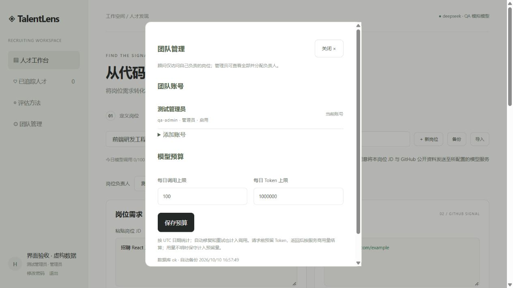
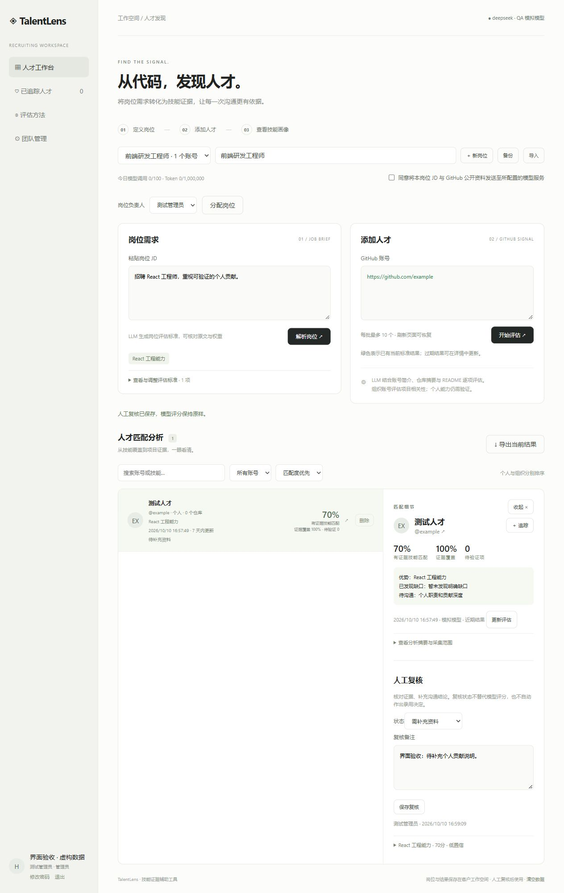
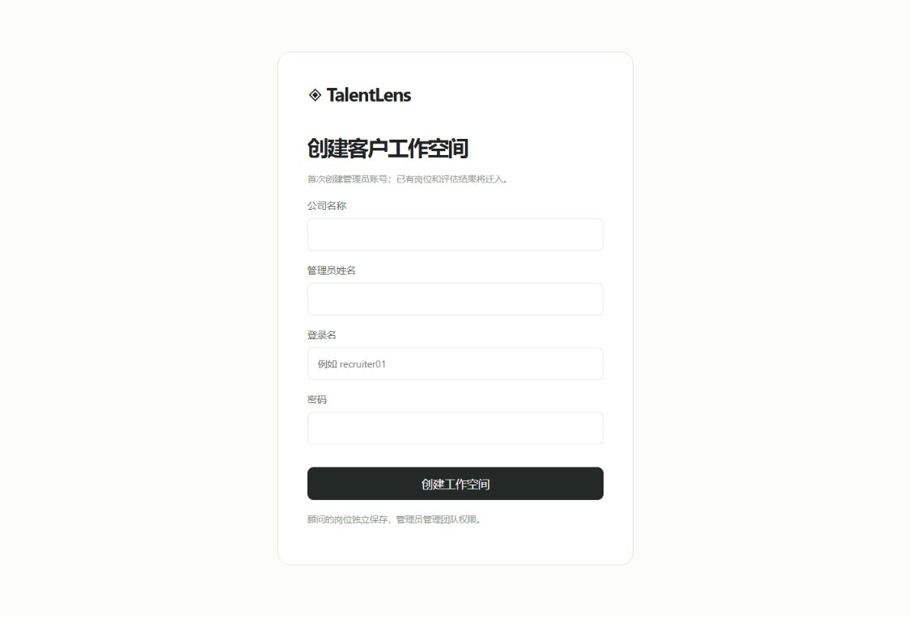

# TalentLens

**从代码，发现人才。让岗位要求与公开项目证据建立可核对的联系。**

TalentLens 是面向技术招聘的技能证据工作台。输入岗位 JD 与 GitHub 账号，它会生成可调整的评估标准，整理相关公开项目资料，并给出有来源的技能分析、证据覆盖情况及待沟通问题。

项目采用 MIT 许可证，支持本机或 Docker 的 Node.js + SQLite 部署，以及 Netlify Functions + PostgreSQL 的云端部署。

猎头可以用它准备人才沟通和客户推荐材料；求职者可以用同一流程自查岗位适配情况，整理项目成果与面试表达。当前版本以猎头公司的团队工作空间为主，求职者自查需要获得账号或自行部署，尚无独立求职者门户。

[在线体验](https://talentlens-github.netlify.app/) · [产品演示](#产品演示与体验) · [使用流程](#使用流程) · [快速开始](#快速开始) · [客户交付指南](CUSTOMER-DELIVERY.md) · [Netlify 部署](NETLIFY-DEPLOY.md) · [与 Codex 协作开发记录](MODEL_COLLAB.md)

## 为什么使用 TalentLens

技术招聘常面临两个信息缺口：JD 没有被拆成一致的评估标准，候选人的项目经历没有被整理成可追溯的证据。TalentLens 把两者放进同一个工作流程，让后续沟通有明确的问题和依据。

| 使用者 | 主要价值 | 可以得到什么 |
| --- | --- | --- |
| 猎头顾问 | 将岗位描述转化为可讨论的标准，减少重复查看仓库的工作 | 核心技能、标准权重、公开项目线索、优势与待验证问题 |
| 猎头公司管理者 | 统一评估流程，管理岗位归属与模型用量 | 账号管理、岗位分配、顾问数据隔离、用量上限、操作审计 |
| 求职者 | 看清公开项目如何支撑目标岗位要求 | 可展示的技能证据、尚未覆盖的要求、个人贡献与成果的沟通提纲 |

例如，JD 要求 React 工程能力时，顾问可以核对相关仓库、依赖与公开贡献线索，再询问候选人的职责和成果；求职者则可以据此补充项目说明，准备“我做了什么、为什么这样做、取得什么结果”的回答。

这些是产品支持的工作方式，并非已经量化验证的招聘效率或录用率提升。

## 产品演示与体验

### 视频导览

[](docs/media/product-tour.mp4)

**[观看产品截图导览视频 · MP4 / 26 秒](docs/media/product-tour.mp4)**

视频由实际产品截图制作，无音轨，依次展示评估与人工复核、团队管理、首次初始化。素材使用虚构账号和模拟模型结果，不包含真实客户数据。这是截图导览，不是端到端操作录屏或真实模型评估演示。仓库平台不支持内嵌视频时，可下载 MP4 播放。

### 体验入口

- **在线体验：[TalentLens 体验站](https://talentlens-github.netlify.app/)**。在线站点的功能以实际部署版本为准；客户团队版部署和权限配置见下方交付指南。
- **本机体验：[http://127.0.0.1:4173/](http://127.0.0.1:4173/)**。完成下方启动步骤后，在运行服务的电脑上打开。
- **客户部署：**按[客户交付指南](CUSTOMER-DELIVERY.md)配置服务器、域名与 HTTPS，使用管理员分配的账号登录。

在线体验站演示账号：

| 登录名 | 密码 |
| --- | --- |
| `zhangsan` | `zhangsanzhangsanzhangsan` |

以上账号仅用于在线体验站；客户自行部署的实例由负责人创建管理员并分配账号。

### 产品截图

**岗位评估与人工复核**：从 JD 和 GitHub 账号出发，核对匹配结果，记录补充资料与沟通结论。匹配细节在点击人才后展开。



<details>
<summary>查看团队管理与首次初始化截图</summary>

**团队管理**：管理员管理成员、模型预算与操作记录。


**首次初始化**：负责人创建公司工作空间与首位管理员，没有预置生产账号密码。



</details>

## 使用流程

1. **定义岗位**：新建岗位并粘贴 JD，确认资料发送范围，由 LLM 提取技能标准、权重、原文依据及验证问题。
2. **核对标准**：检查要求是否准确、能否通过公开资料验证；可以调整标准和权重。
3. **添加人才**：输入 GitHub 用户名或主页链接，一次最多提交 10 个待评估账号。当前标准下已有有效结果的账号自动跳过，输入框中的对应文字显示绿色。
4. **核对证据**：点击人才查看优势、缺口、待验证项和来源。个人与组织可分别筛选，组织结果仅表示项目相关性。
5. **人工复核**：记录候选人职责、补充资料与沟通结论，追踪关注的人才，再导出当前筛选结果。

求职者可以将第三步换成自己的 GitHub 账号，按待验证问题整理面试材料。涉及私有项目时，可在沟通中补充经过授权的材料；当前应用不会读取私有仓库。

## 核心能力

| 能力 | 当前支持 |
| --- | --- |
| JD 解析 | 岗位摘要、技能标准、权重、真实原文引用、评分规则及验证问题 |
| GitHub 证据整理 | 公开账号信息、原创仓库摘要、README、部分依赖文件，以及个人账号的作者匹配提交与公开 PR 线索 |
| 多账号评估 | 后台任务、自动去重、进度恢复、取消、失败单项重试 |
| 结果阅读 | 有证据技能匹配、证据覆盖率、待验证项、置信度与来源引用 |
| 多岗位管理 | 独立岗位及结果、切换、备份与导入；调整权重直接重算 |
| 团队协作 | 管理员查看全部岗位；顾问默认仅访问自己负责的岗位；管理员分配负责人 |
| 人工复核与导出 | 复核状态和备注、追踪、筛选、删除及撤销、当前列表 CSV 导出 |
| 客户运行保障 | 服务端密钥、登录与会话控制、SQLite / PostgreSQL 保存、用量上限、操作审计与本机数据库备份 |

## 如何理解评估结果

**有证据技能匹配度**汇总可公开验证且已获得评分的标准；**证据覆盖率**表示可公开验证标准中已有评分的加权比例；**待验证项**表示尚需补充材料或沟通确认的要求。阅读分数时，应同时查看覆盖率与具体来源。

- 公开资料不足会保留为待验证，不能推断候选人缺乏能力。
- README 自述、技术依赖、提交与 PR 是不同类型的线索。仓库使用相关技术，不等于候选人具有相同深度的个人能力。
- 组织账号展示项目相关性，不能替代个人技能画像。
- 只调整权重无需调用模型；改变 JD 或标准内容后，旧结果需要按新标准更新。
- 模型分数与人工复核独立保存。更新评估后保留复核备注，复核状态恢复为待复核。
- 采集资料超过 7 天会提示更新；采集时间不可靠的旧记录会明确标记。

TalentLens 辅助专业技能沟通，最终招聘判断应结合面试、候选人补充材料与人工复核。

## 快速开始

需要 **Node.js 22.13+**；本机及客户服务器建议使用 Node.js 24 LTS。首次运行先安装锁定版本的依赖。

在项目目录运行：

```powershell
Copy-Item .env.example .env
# 在本机编辑 .env，填写模型 API 密钥，配置示例见下方
npm ci
npm start
```

已有 `.env` 时直接编辑并运行 `npm start`，不要用模板覆盖已有配置。

打开[本机工作空间](http://127.0.0.1:4173/)，由负责人创建公司与管理员，再添加顾问并分配岗位。不要直接打开 `dist/index.html` 或使用纯静态服务器，登录、保存和模型评估需要 Node 后端。

### 模型配置

本项目现有配置使用以下变量。变量名虽为 `OPENAI_*`，当 `OPENAI_BASE_URL` 指向 DeepSeek 官方地址时，服务端会自动使用 DeepSeek 接口：

```dotenv
OPENAI_API_KEY=填写自己的 DeepSeek 密钥
OPENAI_MODEL=deepseek-flash
OPENAI_BASE_URL=https://api.deepseek.com/
GITHUB_TOKEN=
PORT=4173
```

`.env` 中每个变量独占一行，地址不需要转义，也不要在行尾添加反斜杠。修改后重启服务使配置生效。

`.env.example` 提供另一种同样受支持的写法：`LLM_PROVIDER=deepseek` 与 `DEEPSEEK_API_KEY`、`DEEPSEEK_MODEL`、`DEEPSEEK_BASE_URL`。无需把已有可用配置改成这套名称。如果两套变量同时存在，DeepSeek 接口优先读取非空的 `DEEPSEEK_*` 值；使用上方自动识别配置时，不要另设 `LLM_PROVIDER=openai`。

`GITHUB_TOKEN` 可留空；配置后以授权方式访问 GitHub 公共 API。项目也支持 OpenAI Responses API。密钥仅由服务端读取，不发送给浏览器，`.env` 不应提交或打包。

## 客户交付与数据管理

当前客户版采用**一家公司的独立实例**。顾问默认隔离，管理员查看全部岗位并分配负责人。不同客户应分别配置实例、数据库和密钥。

- 本机与 Docker 版本使用 Node.js + SQLite，适合单个应用进程。
- Netlify 云版使用 Functions、Background Functions 与 PostgreSQL，不在临时文件系统保存数据库。

岗位、评估、追踪和任务保存在 `data/talentlens.sqlite`，浏览器仅保留当前账号的会话级输入草稿。首次初始化会迁移旧 `data/workspace.json`，原 JSON 保留。

JD 与采集到的公开 GitHub 资料会发送至配置的模型服务；调用前需要确认发送范围，数据保留取决于服务商政策。应用不会采集私有仓库。采集范围有上限：最多读取 300 个公开原创仓库，模型读取最多 60 个仓库摘要、8 份 README，以及部分相关仓库依赖与贡献线索，因此结果不是完整代码审计。

部署前请阅读[客户交付与验收指南](CUSTOMER-DELIVERY.md)，其中包括 HTTPS 部署、初始化令牌、账号管理、用量预算、备份恢复和验收步骤。仓库提供 Docker 与 Caddy 配置；Netlify 云端部署见 [NETLIFY-DEPLOY.md](NETLIFY-DEPLOY.md)。两种方式都需要在客户实际环境验证。

当前尚未提供独立求职者门户、多租户自助注册、SSO/MFA、邮件找回密码、ATS 集成及高可用部署。正式交付应按客户规模和内部流程评估这些需求。

## 验证与维护

离线测试不消耗模型 API 额度：

```powershell
npm test
npm run test:cloud
npm run build
```

测试覆盖 JD 引用校验、模型输出校验、评分口径、标准变更、批量去重、保存恢复、任务取消与重启恢复，以及客户账号与权限边界。`quality-fixtures.json` 是人工定义的边界案例，不是招聘评估准确率报告；模型效果需要使用经授权、人工标注的真实样本持续校准。

本机 SQLite 数据库备份：

```powershell
npm run backup
```

恢复和管理员维护请使用[交付指南](CUSTOMER-DELIVERY.md)中的完整流程。云版需要另行配置 PostgreSQL 快照策略。模型调用次数与 Token 上限用于限制用量，实际费用以服务商账单为准。

## 项目结构

开发过程见 [MODEL_COLLAB.md](MODEL_COLLAB.md)；个人项目能力与岗位方向摘要见 [TalentLens_简历片段.txt](TalentLens_简历片段.txt)。

```text
dist/                    前端界面与评分核心
server.mjs               模型调用、JD 解析与证据评估
client-server.mjs        客户认证、权限与任务接口
client-store.mjs         SQLite、账号、用量与审计
cloud-server.mjs         云端 API 与后台任务入口
pg-store.mjs             PostgreSQL 数据保存与权限边界
evidence.mjs             GitHub 公开证据采集
manage.mjs               数据库与账号维护命令
netlify/                  Functions、后台任务与数据库迁移
docs/media/              README 截图与视频素材
CUSTOMER-DELIVERY.md     客户部署、维护与验收说明
NETLIFY-DEPLOY.md         Netlify 与 PostgreSQL 部署说明
```

技术接入参考：[DeepSeek JSON Output](https://api-docs.deepseek.com/guides/json_mode/)。
